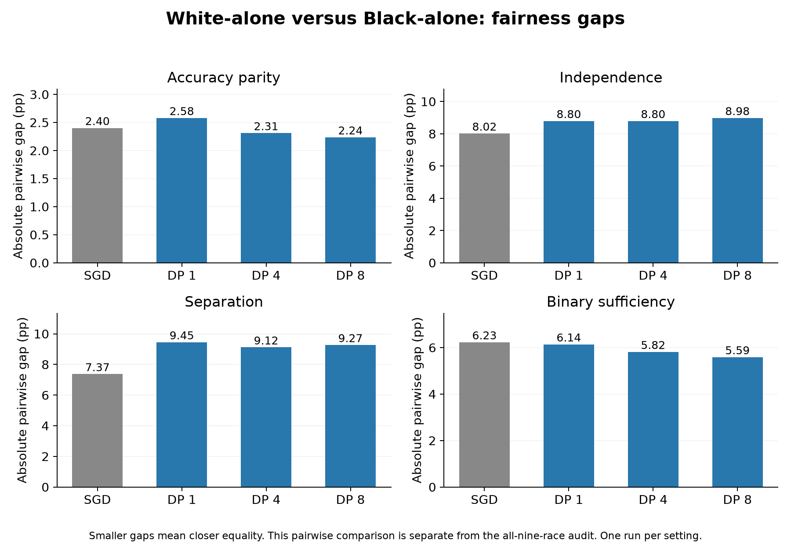
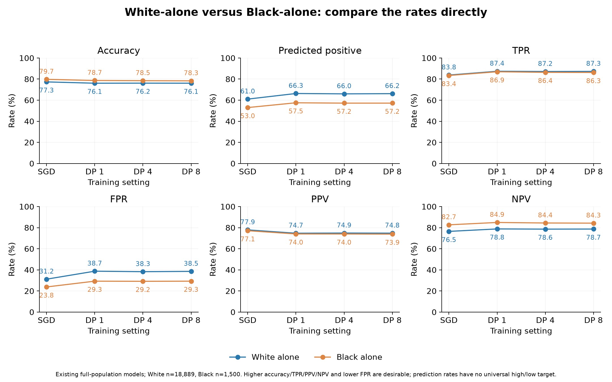

# Fairness: what we want and what the results show

**Read in this order:** the goals below, the White/Black example, then the detailed tables. [GUIDE.md](GUIDE.md) explains each metric with pictures; [RESULTS.md](RESULTS.md) contains all settings, full race/sex rates, and counts. [Printable illustrated guide](fairness_metric_guide.pdf).

## 1. Do we want equal rates or bigger differences?

**For every parity criterion, we want the specified rates to be equal across groups: the desired gap is zero. A bigger gap means more disparity.** Predictive quality is a separate question: equal 50% accuracies have perfect accuracy parity but are poor predictions. We want useful performance alongside parity.

| Fairness criterion | What should be equal across groups? | What rate levels are desirable? | Desired gap |
| --- | --- | --- | --- |
| Accuracy parity | Accuracy | High accuracy for both groups | 0; smaller is closer to parity |
| Independence | Positive-prediction rate | No universal high/low target; equality is the criterion | 0; smaller is closer to parity |
| Separation / equalized odds | TPR equal AND FPR equal | High TPR (find positives), low FPR (avoid false alarms) | 0; smaller is closer to parity |
| Binary sufficiency | PPV equal AND NPV equal | High PPV and NPV (reliable predictions) | 0; smaller is closer to parity |

These are criteria for evaluation; our current SGD/DP-SGD models minimize prediction loss and do not yet enforce a fairness constraint. The criteria can conflict, especially when actual-positive rates differ. We do not expect all gaps to be zero simultaneously. [Formal definitions](https://fairmlbook.org/classification.html).

## 2. What is the race comparison or baseline?

- **Model baseline:** ordinary SGD. Compare each group's SGD accuracy with its DP accuracy to measure privacy-related accuracy loss.
- **All-race fairness gap:** highest minus lowest rate among all nine race categories. No fixed reference race; different metrics can use different endpoint groups.
- **Specific comparison below:** White-alone versus Black-alone; use the absolute difference between their rates. Neither race is ground truth or the standard the other group must match. Both groups' rates matter.

This is a descriptive comparison of the existing full-population models. No people were removed from training, no races were merged, and no new race-restricted models were trained. One pair does not establish fairness across all race categories.

## 3. Concrete race example: DP-SGD at epsilon approximately 1

**Actual saved development results, one run.** Positive means ESR=1 (civilian employed, at work); negative includes all other eligible ESR values. Rates below are percentages; differences are percentage points. Gaps are calculated before rounding.

| Statistic | White alone | Black alone | Absolute difference (pp) | How to read / desired direction |
| --- | --- | --- | --- | --- |
| Number of records | 18,889 | 1,500 | Not a fairness gap | Counts describe support; do not force equal sample sizes |
| Actual-positive rate | 56.70 | 49.00 | 7.70 | Observed data context; do not alter labels to equalize this |
| Accuracy | 76.09 | 78.67 | 2.58 | High and equal |
| Predicted positive | 66.33 | 57.53 | 8.80 | Equal; not necessarily high |
| TPR | 87.40 | 86.94 | 0.47 | High and equal |
| FPR | 38.73 | 29.28 | 9.45 | Low and equal |
| PPV | 74.71 | 74.04 | 0.67 | High and equal |
| NPV | 78.79 | 84.93 | 6.14 | High and equal |

**Interpretation:**

- Accuracy: 76.09% versus 78.67%; the White-alone group has 2.58 points lower accuracy in this model.
- Independence: predicted-positive rates are 66.33% and 57.53%. Their difference is 8.80 points; equality would mean the same prediction rate.
- Separation: TPR differs by only 0.47 points, but FPR differs by 9.45 points. Thus the separation gap is 9.45 points, driven by false alarms. Of 100 actual negatives, about 39 White-alone versus 29 Black-alone people are predicted positive.
- Sufficiency: PPV differs by 0.67 points, but NPV differs by 6.14 points. The larger NPV difference determines this pair's sufficiency gap.
- Privacy impact: compared with each group's SGD baseline, accuracy falls by 1.24 points for White-alone and 1.07 for Black-alone. These are changes between models, not parity gaps.

## 4. The same race pair across privacy budgets

| Model | Accuracy parity gap (pp) | Independence gap (pp) | Separation gap (pp) | Binary sufficiency gap (pp) |
| --- | --- | --- | --- | --- |
| SGD | 2.40 | 8.02 | 7.37 | 6.23 |
| DP epsilon 1 | 2.58 | 8.80 | 9.45 | 6.14 |
| DP epsilon 4 | 2.31 | 8.80 | 9.12 | 5.82 |
| DP epsilon 8 | 2.24 | 8.98 | 9.27 | 5.59 |

For this pair, the separation gap rises from 7.37 points under SGD to 9.45 at epsilon approximately 1. The sex separation gap moves in the opposite direction in the same experiment. This is why we identify the groups and inspect both rates before saying a model became more or less fair.

## 5. Why keep the full-race audit?

The two-record Alaska Native-alone group makes full-race TPR and PPV undefined. Its 100% accuracy and 0% positive-prediction rate also strongly influence the extreme full-race gaps. The White/Black comparison is defined and easier to interpret, but does not replace that audit or explain other groups. [RESULTS.md](RESULTS.md) identifies the endpoint groups for each full-race accuracy/selection-rate gap.

All results are single runs on the development set, not final test results. Repeated runs are needed before claiming stable trends. Neither these rates nor parity gaps establish causal discrimination.

## Rebuild

Run ` .\.venv\Scripts\python.exe scripts\report_fairness.py ` for observed results and plots; ` .\.venv\Scripts\python.exe scripts\build_fairness_guide.py ` for the teaching images/PDF. Both commands read saved artifacts without retraining.
