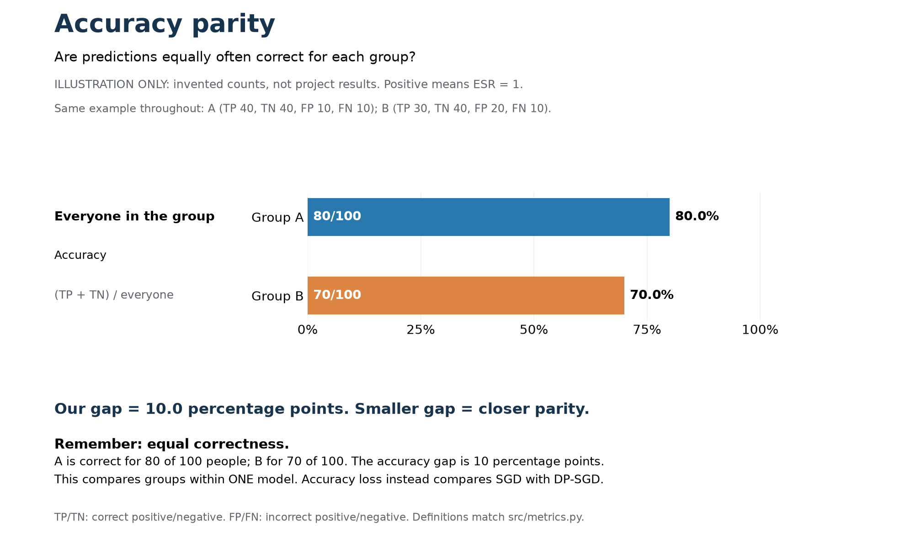
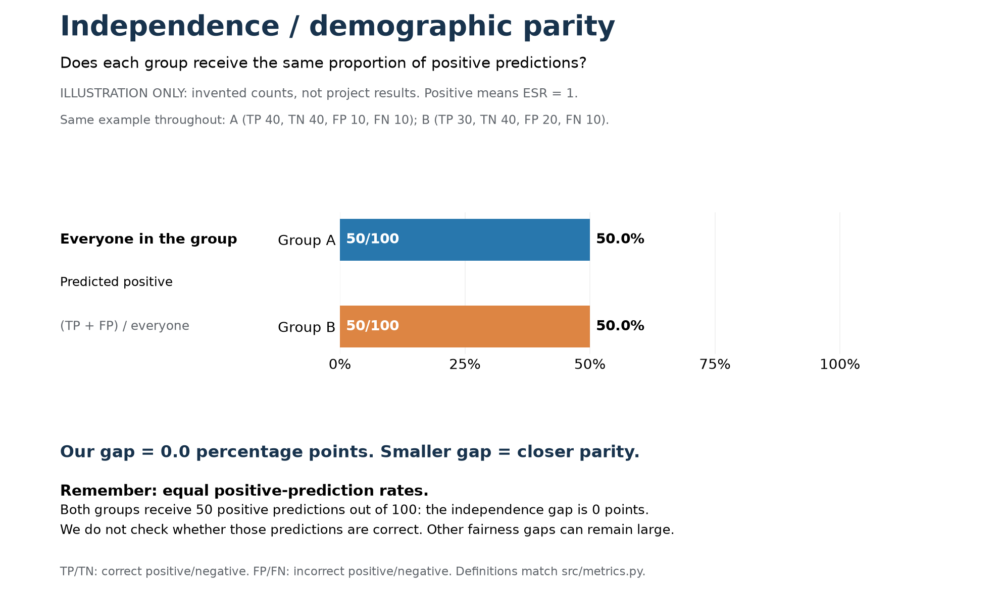
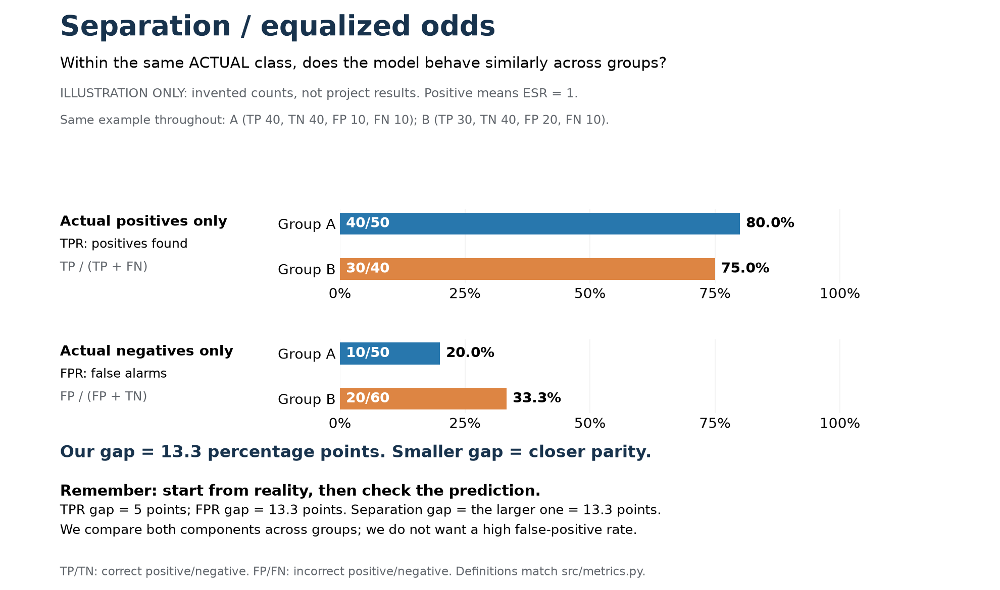
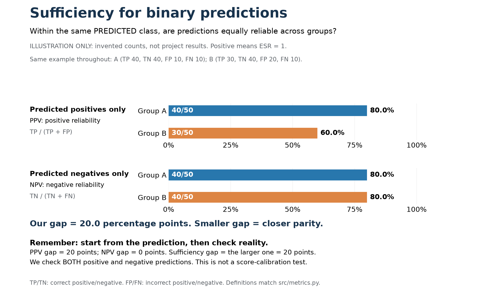

# Understanding our privacy and fairness measurements

This is a learning companion to the two-page progress report. All counts in these pictures are invented, not experimental results. The drawing script checks their rates against our actual `src/metrics.py` functions.

## First, what do positive and negative mean?

`Y` is the real label; `Y_hat` is the model's prediction after applying threshold 0.5. In our current task, positive means **ESR = 1: civilian employed, at work**. Negative means any other eligible ESR code; it does not mean only unemployed. Predicting positive does not give someone a job.

- **TP:** actual positive, predicted positive. Correct.
- **TN:** actual negative, predicted negative. Correct.
- **FP:** actual negative, predicted positive. False alarm.
- **FN:** actual positive, predicted negative. Missed positive.

We calculate a rate for each group, then a **gap = highest group rate minus lowest group rate**. A gap of 0.10 is **10 percentage points**, not a 10% relative change. Sex and race are audited separately, with race-by-sex intersections also retained. Undefined rates stay undefined, rather than becoming zero.

## 1. Accuracy parity: equal correctness



**Ask:** "Is the model equally often correct for each group?"

Accuracy is `(TP + TN) / n`. The accuracy gap compares groups **within one model**. The example gives 80% versus 70%, so the gap is 10 points.

**Different from accuracy loss:** if one group's SGD accuracy is 80% and its DP-SGD accuracy is 78%, its privacy-related accuracy loss is 2 points. This compares **two models for the same group**. We report both questions; equal losses need not give equal final accuracies.

## 2. Independence: equal positive-prediction rates



**Ask:** "Out of everyone in each group, how many are predicted positive?"

The selection rate is `(TP + FP) / n`. In the example, both rates are 50%, so the independence gap is zero. This calculation does not look at the real labels, so a zero gap does not guarantee equal accuracy or equal errors. Also called **demographic parity**.

## 3. Separation: start from reality



**Ask:** "For people with the same real label, does the model behave similarly across groups?"

- Among **actual positives**, compare how many the model finds: `TPR = TP / (TP + FN)`.
- Among **actual negatives**, compare how many receive false alarms: `FPR = FP / (FP + TN)`.

Our separation gap is `max(TPR gap, FPR gap)`. The example has gaps of 5 and 13.3 points, so we report 13.3 points. This is **equalized odds**; equal opportunity checks TPR alone. Equality of rates and desirable rate levels are separate: ideally TPR is high and FPR is low.

## 4. Sufficiency: start from the prediction



**Ask:** "When the model gives the same prediction, is it equally trustworthy for each group?"

- Among **predicted positives**, compare the fraction actually positive: `PPV = TP / (TP + FP)`.
- Among **predicted negatives**, compare the fraction actually negative: `NPV = TN / (TN + FN)`.

Our binary sufficiency gap is `max(PPV gap, NPV gap)`. The example has gaps of 20 and zero points, so we report 20 points. This checks binary decisions, not calibration of the original probability scores.

**Memory aid:** separation groups people by the **real answer first**; sufficiency groups them by the **model's answer first**. Independence ignores the real answer. Accuracy parity checks overall correctness.

These are different criteria, not interchangeable fairness scores. A smaller gap on one can accompany a larger gap on another. See the [Fairness and Machine Learning definitions](https://fairmlbook.org/classification.html) for the formal conditional-independence statements.

## Privacy budget: smaller epsilon means stronger privacy

At a fixed delta and privacy scope, epsilon 1 gives a stronger guarantee than epsilon 4, which is stronger than epsilon 8. Epsilon is a privacy budget, not the prediction threshold. Our prediction threshold is separately fixed at 0.5.

DP bounds how much the distribution of a randomized algorithm's output can change when one person's training record is added or removed. Smaller epsilon imposes a tighter bound. With the rest of our DP-SGD settings fixed, stronger privacy requires more noise, which can reduce accuracy; this is not a promise that every individual run will follow a monotonic trend. Delta is the additive slack in approximate DP, not a direct probability that somebody's record is exposed. Budgets apply per run under our documented auxiliary-data assumption; multiple releases require composition accounting. See [Dwork and Roth](https://www.cis.upenn.edu/~aaroth/Papers/privacybook.pdf).

## Race categories are inherited from the Census

We retain all nine original `RAC1P` codes; we have not merged people into new race categories.

| Code | Census label | How to interpret it |
| --- | --- | --- |
| 8 | Some Other Race alone | The Census's category for a race response outside the other listed race categories, without another race in combination |
| 9 | Two or More Races | The Census's category for people reporting multiple races, for example White and Asian |

"Some Other Race alone" is not our catch-all for small groups and is not a synonym for Hispanic ethnicity. "Two or More Races" is not a merger we made. These categories are broad because `RAC1P` is already a Census recode. See the [2018 ACS PUMS dictionary, printed page 103](https://www2.census.gov/programs-surveys/acs/tech_docs/pums/data_dict/PUMS_Data_Dictionary_2018.pdf).

The group-loss plot displays only race groups with at least 500 development records for readability. That display filter does not merge categories or remove people from training or the full audit. A later, separately labeled White-alone/Black-alone comparison would be a different cohort, not a relabeling of the current results.

## Rebuild the illustrations

```powershell
.\.venv\Scripts\python.exe scripts\build_fairness_guide.py
```

Outputs: four PNGs under `figures/fairness_guide/` and a four-page printable guide at `output/pdf/fairness_metric_guide.pdf`. No training or test records are read.
