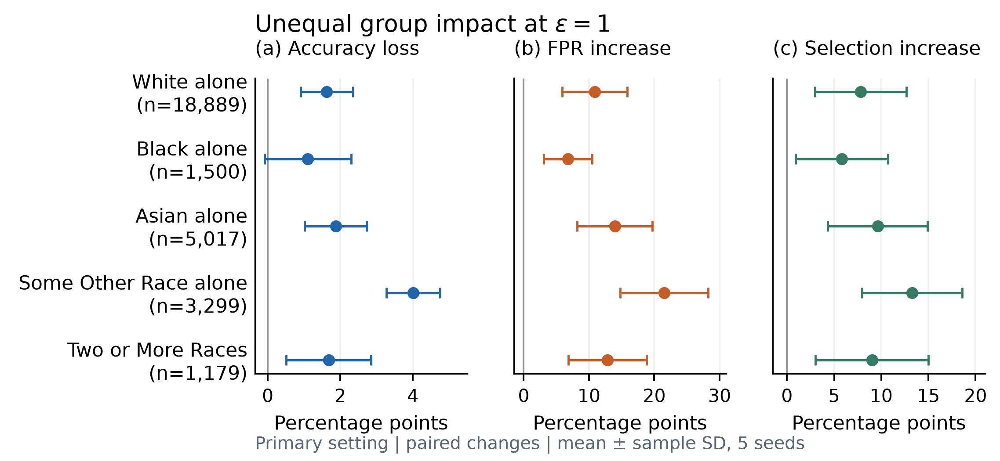

# Findings: privacy, group outcomes and clipping

**Current evidence:** California ACS Employment 2018; primary setting includes sex/race predictors; five initialization-matched seeds; development evaluation only. All +/- values below are sample SD across seeds. Rates are percent; differences and gaps are percentage points (pp). See [project_log.md](project_log.md) for settings/definitions and [plan.md](plan.md) for remaining work.

## 1. Unequal accuracy losses and positive-prediction shifts

DP-SGD at epsilon1 reduces overall accuracy by **1.91 +/- 0.71 pp**, with different costs across groups. It predicts the positive class more often for both sexes and all five supported race groups in their seed means. TPR and FPR both increase; selection/FPR increases hold in all 25 supported-race group-seed pairs, while TPR increases in 24/25.

On this fixed cohort, `change in accuracy = positive fraction * change in TPR - negative fraction * change in FPR`. The accuracy cost from additional false positives outweighs the benefit from recovered positives overall and in each supported group's mean. This describes prediction outcomes, not a proven gradient mechanism.

| Group | Paired accuracy loss (pp) | FPR increase (pp) |
| --- | --- | --- |
| Male | 2.26 +/- 0.85 | 13.35 +/- 4.72 |
| Female | 1.57 +/- 0.73 | 11.56 +/- 5.74 |
| White alone | 1.63 +/- 0.72 | 10.90 +/- 4.98 |
| Black alone | 1.11 +/- 1.19 | 6.77 +/- 3.69 |
| Asian alone | 1.87 +/- 0.86 | 13.94 +/- 5.72 |
| Some Other Race alone | 4.01 +/- 0.74 | 21.52 +/- 6.73 |
| Two or More Races | 1.68 +/- 1.17 | 12.83 +/- 5.98 |

Some Other Race-alone has the largest supported-group loss (**4.01 pp**) and FPR increase (**21.52 pp**), compared with **6.77 pp** higher FPR for Black-alone. These are original Census categories, not merged groups. Supported race means development n>=500: White 18,889; Black 1,500; Asian 5,017; Some Other Race 3,299; Two or More Races 1,179. Smaller races and all intersections remain in the CSVs.

Points/whiskers: paired mean +/- sample SD, five seeds. Accuracy loss is SGD minus DP; FPR/selection increases are DP minus SGD. Each panel has its own labeled pp scale. These are training-variation bars, not confidence intervals.

## 2. Different effects on fairness

Sex separation falls **7.75 -> 5.03 pp**, whereas supported-race separation rises **16.72 -> 31.24 pp**, both in 5/5 seeds. Other criteria differ:

| Gap (pp) | Sex SGD | Sex DP1 | Race SGD | Race DP1 |
| --- | --- | --- | --- | --- |
| Accuracy parity | 6.86 +/- 0.31 | 6.17 +/- 0.48 | 2.85 +/- 0.54 | 4.91 +/- 0.48 |
| Independence | 7.82 +/- 2.34 | 6.45 +/- 1.26 | 17.83 +/- 0.99 | 25.26 +/- 1.07 |
| Separation | 7.75 +/- 3.00 | 5.03 +/- 0.71 | 16.72 +/- 2.77 | 31.24 +/- 1.44 |
| Binary sufficiency | 9.29 +/- 0.46 | 8.72 +/- 0.76 | 4.64 +/- 0.95 | 4.28 +/- 0.43 |

All gaps aim for zero. Accuracy parity compares correctness; independence compares positive-prediction rates; separation compares both TPR/FPR; binary sufficiency compares both PPV/NPV and does not establish score calibration. Calculate gaps within a seed before averaging; the range of averaged rates can differ.

Under DP1, Black-alone FPR is 26.61% versus 57.86% for Some Other Race-alone; their FPR range drives race separation in all five seeds. Sex parity improves alongside worse absolute outcomes: male FPR rises 28.31% -> 41.66%, female FPR 31.37% -> 42.93%, and both lose accuracy. Female TPR rises more, narrowing the mean TPR difference. Race sufficiency improves while the other three race gaps worsen; closer sufficiency also coexists with lower PPV.

Feature selection matters. Excluding sex/race reverses which sex loses more accuracy: female 1.45 vs male 1.04 pp, compared with primary male 2.26 vs female 1.57 pp. Primary sex gap means all shrink; under exclusion sex accuracy/independence gaps instead increase. Thus DP does not have one universal fairness effect.

## 3. Clipping and privacy-budget effects

| Method | Accuracy (%) +/- SD | Sex separation (pp) | Race separation (pp) |
| --- | --- | --- | --- |
| SGD | 77.42 +/- 0.55 | 7.75 | 16.72 |
| Poisson-SGD | 77.57 +/- 0.41 | 8.00 | 18.04 |
| Poisson-SGD + clip | 75.51 +/- 0.35 | 4.88 | 30.80 |
| DP-SGD epsilon1 | 75.52 +/- 0.34 | 5.03 | 31.24 |
| DP-SGD epsilon4 | 75.55 +/- 0.33 | 5.04 | 30.79 |
| DP-SGD epsilon8 | 75.45 +/- 0.35 | 5.01 | 30.96 |

Poisson sampling has little mean effect on accuracy here. Adding clipping to the matched non-private Poisson control changes accuracy by **-2.055 +/- 0.477 pp** and race separation 18.04 -> 30.80 pp. DP1 minus clipped/no-noise accuracy is **+0.005 +/- 0.051 pp**. The large reduction is already present without added noise. However, DP minibatches/noise are independently randomized: this is evidence under the tested settings, not proof that clipping is the sole cause or noise is irrelevant.

At fixed C=1, mean accuracy spans only **0.098 pp** across epsilon1/4/8; the largest mean span among the eight sex/race fairness gaps is 0.451 pp. Effects are small, not absent: epsilon8 minus epsilon1 accuracy is **-0.066 +/- 0.042 pp**, negative in 5/5 primary pairs. Larger epsilon gives weaker privacy at fixed delta; it does not guarantee more accuracy in a finite training run.

The immediate next question is therefore **clipping-norm sensitivity at fixed epsilon**, rather than a broader epsilon sweep. Compare C in {0.5,1,2,5} with correctly scaled noise/accounting, matched noise-free controls and group outcomes. Also repeat on additional Folktables tasks, starting with ACSIncome. These experiments and LFR/EO are planned, not completed.

## Limits and supporting records

One task/state/year, five seeds, development-only evaluation, fixed C=1/architecture/threshold, and omitted tiny groups in headline race gaps limit generalization. No final-test or intervention results exist yet. Public auxiliary-data assumptions and household overlap restrict the privacy interpretation; the repository as a whole is not a private release.

All numerical detail remains in [aggregate CSVs](results/controlled_v2/aggregate/) and [per-run records](results/controlled_v2/runs/). The [current progress report](reports/progress_report/ECE285_progress_report.pdf) and the user-edited [Overleaf ZIP](reports/progress_report/ECE285_progress_report_overleaf.zip) are separate submission artifacts. This is the one maintained findings note; aggregation/figure scripts do not recreate old findings/log documents.
