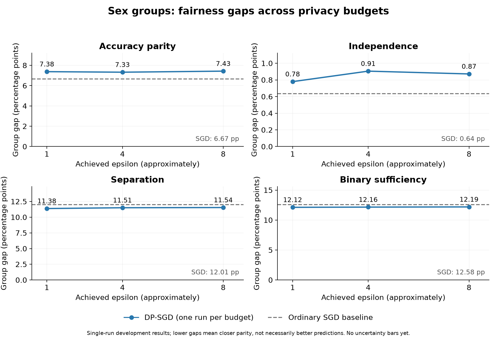
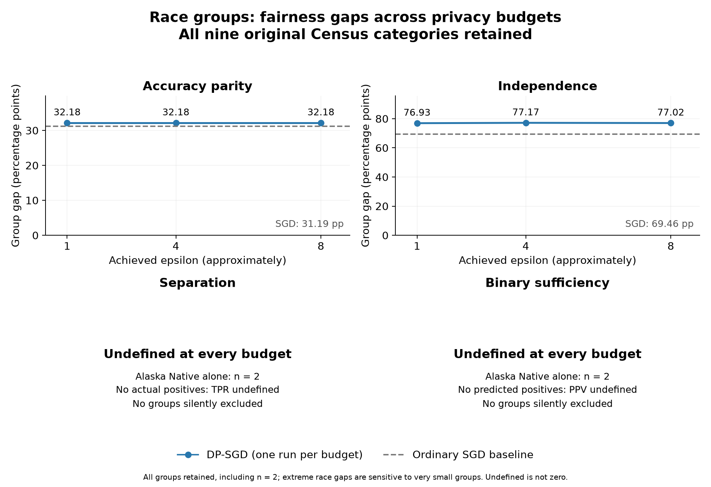
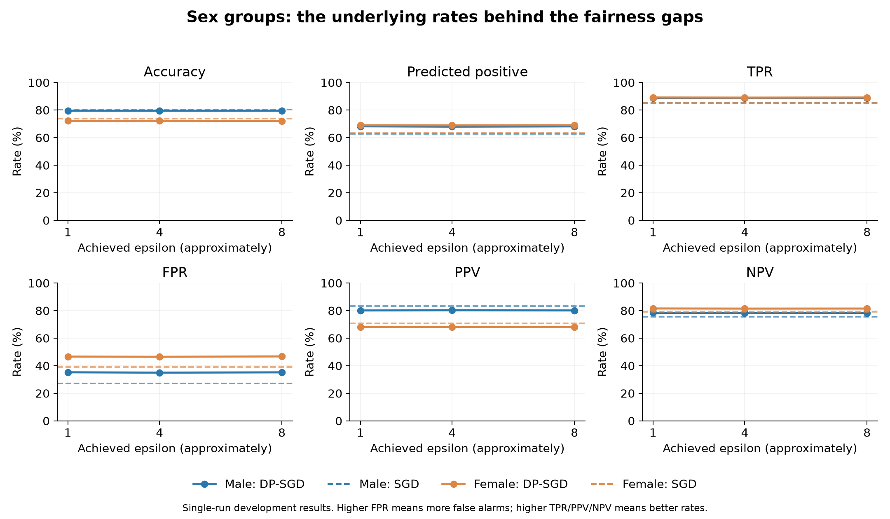
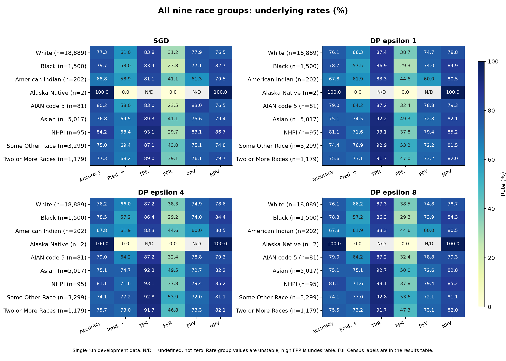

# Observed fairness results across privacy budgets

**Single-run development results.** Same 30,264 records, threshold 0.5, no fairness intervention yet. No retraining or test evaluation was performed to produce these tables.

## Read the units first

The four fairness measurements below are **group gaps in percentage points**; lower means closer parity. They are not per-group rates. The later tables show the rates themselves, in percent. A 10-point gap means a difference such as 80% versus 70%.

- Accuracy parity: gap in accuracy.
- Independence: gap in positive-prediction rate.
- Separation: maximum of TPR and FPR gaps.
- Binary sufficiency: maximum of PPV and NPV gaps.

## Sex: fairness gaps (pp)

| Model / target epsilon | Accuracy parity | Independence | Separation | Binary sufficiency |
| --- | --- | --- | --- | --- |
| SGD | 6.67 | 0.64 | 12.01 | 12.58 |
| DP epsilon 1 | 7.38 | 0.78 | 11.38 | 12.12 |
| DP epsilon 4 | 7.33 | 0.91 | 11.51 | 12.16 |
| DP epsilon 8 | 7.43 | 0.87 | 11.54 | 12.19 |

## Race: all nine original categories: fairness gaps (pp)

| Model / target epsilon | Accuracy parity | Independence | Separation | Binary sufficiency |
| --- | --- | --- | --- | --- |
| SGD | 31.19 | 69.46 | undefined | undefined |
| DP epsilon 1 | 32.18 | 76.93 | undefined | undefined |
| DP epsilon 4 | 32.18 | 77.17 | undefined | undefined |
| DP epsilon 8 | 32.18 | 77.02 | undefined | undefined |

Race separation/sufficiency remain undefined because Alaska Native alone has n=2, zero actual positives, and zero predicted positives in every run. TPR and PPV have zero denominators. That group also has 100% accuracy and a 0% positive-prediction rate, strongly affecting the reported full-race accuracy/independence gaps. No categories have been dropped or merged.

## Sex: component gaps (pp)

| Model | TPR gap | FPR gap | PPV gap | NPV gap |
| --- | --- | --- | --- | --- |
| SGD | 0.22 | 12.01 | 12.58 | 3.49 |
| DP epsilon 1 | 0.30 | 11.38 | 12.12 | 3.16 |
| DP epsilon 4 | 0.43 | 11.51 | 12.16 | 3.34 |
| DP epsilon 8 | 0.33 | 11.54 | 12.19 | 3.16 |

## Sex: underlying group rates (%)

TPR = actual positives found; FPR = actual negatives falsely predicted positive; PPV/NPV = reliability of positive/negative predictions.

| Model | Group | n | Accuracy (%) | Predicted positive (%) | TPR (%) | FPR (%) | PPV (%) | NPV (%) |
| --- | --- | --- | --- | --- | --- | --- | --- | --- |
| SGD | Male | 14,826 | 80.48 | 62.89 | 85.24 | 27.13 | 83.41 | 75.52 |
| SGD | Female | 15,438 | 73.81 | 63.53 | 85.46 | 39.14 | 70.83 | 79.01 |
| DP epsilon 1 | Male | 14,826 | 79.58 | 68.25 | 88.86 | 35.27 | 80.13 | 78.42 |
| DP epsilon 1 | Female | 15,438 | 72.20 | 69.03 | 89.16 | 46.65 | 68.00 | 81.57 |
| DP epsilon 4 | Male | 14,826 | 79.55 | 68.02 | 88.65 | 35.01 | 80.21 | 78.15 |
| DP epsilon 4 | Female | 15,438 | 72.22 | 68.92 | 89.07 | 46.51 | 68.05 | 81.49 |
| DP epsilon 8 | Male | 14,826 | 79.57 | 68.21 | 88.82 | 35.23 | 80.13 | 78.36 |
| DP epsilon 8 | Female | 15,438 | 72.14 | 69.08 | 89.15 | 46.77 | 67.94 | 81.52 |

## Race: underlying group rates (%)

### SGD

| Group | n | Actual + | Predicted + | Accuracy (%) | Predicted positive (%) | TPR (%) | FPR (%) | PPV (%) | NPV (%) |
| --- | --- | --- | --- | --- | --- | --- | --- | --- | --- |
| White alone | 18,889 | 10710 | 11526 | 77.33 | 61.02 | 83.82 | 31.17 | 77.88 | 76.46 |
| Black or African American alone | 1,500 | 735 | 795 | 79.73 | 53.00 | 83.40 | 23.79 | 77.11 | 82.70 |
| American Indian alone | 202 | 90 | 119 | 68.81 | 58.91 | 81.11 | 41.07 | 61.34 | 79.52 |
| Alaska Native alone | 2 | 0 | 0 | 100.00 | 0.00 | undefined | 0.00 | undefined | 100.00 |
| AIAN specified/unspecified; no other races | 81 | 47 | 47 | 80.25 | 58.02 | 82.98 | 23.53 | 82.98 | 76.47 |
| Asian alone | 5,017 | 2950 | 3485 | 76.78 | 69.46 | 89.32 | 41.12 | 75.61 | 79.44 |
| Native Hawaiian / Other Pacific Islander alone | 95 | 58 | 65 | 84.21 | 68.42 | 93.10 | 29.73 | 83.08 | 86.67 |
| Some Other Race alone | 3,299 | 1974 | 2290 | 75.02 | 69.41 | 87.13 | 43.02 | 75.11 | 74.83 |
| Two or More Races | 1,179 | 688 | 804 | 77.27 | 68.19 | 88.95 | 39.10 | 76.12 | 79.73 |

### DP epsilon 1

| Group | n | Actual + | Predicted + | Accuracy (%) | Predicted positive (%) | TPR (%) | FPR (%) | PPV (%) | NPV (%) |
| --- | --- | --- | --- | --- | --- | --- | --- | --- | --- |
| White alone | 18,889 | 10710 | 12529 | 76.09 | 66.33 | 87.40 | 38.73 | 74.71 | 78.79 |
| Black or African American alone | 1,500 | 735 | 863 | 78.67 | 57.53 | 86.94 | 29.28 | 74.04 | 84.93 |
| American Indian alone | 202 | 90 | 125 | 67.82 | 61.88 | 83.33 | 44.64 | 60.00 | 80.52 |
| Alaska Native alone | 2 | 0 | 0 | 100.00 | 0.00 | undefined | 0.00 | undefined | 100.00 |
| AIAN specified/unspecified; no other races | 81 | 47 | 52 | 79.01 | 64.20 | 87.23 | 32.35 | 78.85 | 79.31 |
| Asian alone | 5,017 | 2950 | 3739 | 75.14 | 74.53 | 92.24 | 49.25 | 72.77 | 82.08 |
| Native Hawaiian / Other Pacific Islander alone | 95 | 58 | 68 | 81.05 | 71.58 | 93.10 | 37.84 | 79.41 | 85.19 |
| Some Other Race alone | 3,299 | 1974 | 2538 | 74.36 | 76.93 | 92.86 | 53.21 | 72.22 | 81.47 |
| Two or More Races | 1,179 | 688 | 862 | 75.57 | 73.11 | 91.72 | 47.05 | 73.20 | 82.02 |

### DP epsilon 4

| Group | n | Actual + | Predicted + | Accuracy (%) | Predicted positive (%) | TPR (%) | FPR (%) | PPV (%) | NPV (%) |
| --- | --- | --- | --- | --- | --- | --- | --- | --- | --- |
| White alone | 18,889 | 10710 | 12466 | 76.16 | 66.00 | 87.17 | 38.27 | 74.89 | 78.61 |
| Black or African American alone | 1,500 | 735 | 858 | 78.47 | 57.20 | 86.39 | 29.15 | 74.01 | 84.42 |
| American Indian alone | 202 | 90 | 125 | 67.82 | 61.88 | 83.33 | 44.64 | 60.00 | 80.52 |
| Alaska Native alone | 2 | 0 | 0 | 100.00 | 0.00 | undefined | 0.00 | undefined | 100.00 |
| AIAN specified/unspecified; no other races | 81 | 47 | 52 | 79.01 | 64.20 | 87.23 | 32.35 | 78.85 | 79.31 |
| Asian alone | 5,017 | 2950 | 3748 | 75.08 | 74.71 | 92.34 | 49.54 | 72.68 | 82.19 |
| Native Hawaiian / Other Pacific Islander alone | 95 | 58 | 68 | 81.05 | 71.58 | 93.10 | 37.84 | 79.41 | 85.19 |
| Some Other Race alone | 3,299 | 1974 | 2546 | 74.05 | 77.17 | 92.81 | 53.89 | 71.96 | 81.14 |
| Two or More Races | 1,179 | 688 | 861 | 75.66 | 73.03 | 91.72 | 46.84 | 73.29 | 82.08 |

### DP epsilon 8

| Group | n | Actual + | Predicted + | Accuracy (%) | Predicted positive (%) | TPR (%) | FPR (%) | PPV (%) | NPV (%) |
| --- | --- | --- | --- | --- | --- | --- | --- | --- | --- |
| White alone | 18,889 | 10710 | 12501 | 76.10 | 66.18 | 87.28 | 38.55 | 74.78 | 78.68 |
| Black or African American alone | 1,500 | 735 | 858 | 78.33 | 57.20 | 86.26 | 29.28 | 73.89 | 84.27 |
| American Indian alone | 202 | 90 | 125 | 67.82 | 61.88 | 83.33 | 44.64 | 60.00 | 80.52 |
| Alaska Native alone | 2 | 0 | 0 | 100.00 | 0.00 | undefined | 0.00 | undefined | 100.00 |
| AIAN specified/unspecified; no other races | 81 | 47 | 52 | 79.01 | 64.20 | 87.23 | 32.35 | 78.85 | 79.31 |
| Asian alone | 5,017 | 2950 | 3770 | 75.12 | 75.14 | 92.75 | 50.02 | 72.57 | 82.84 |
| Native Hawaiian / Other Pacific Islander alone | 95 | 58 | 68 | 81.05 | 71.58 | 93.10 | 37.84 | 79.41 | 85.19 |
| Some Other Race alone | 3,299 | 1974 | 2541 | 74.14 | 77.02 | 92.76 | 53.58 | 72.06 | 81.13 |
| Two or More Races | 1,179 | 688 | 863 | 75.49 | 73.20 | 91.72 | 47.25 | 73.12 | 81.96 |

## Interpretation and provenance

At epsilon approximately 1 versus SGD, the sex accuracy gap increases (6.67 to 7.38 pp) and independence gap increases (0.64 to 0.78 pp), while separation decreases (12.01 to 11.38 pp) and sufficiency decreases (12.58 to 12.12 pp). A smaller gap can accompany worse rates: both male and female false-positive rates increase. Inspect absolute group performance alongside parity.

All settings have only one run; no uncertainty bars or significance claims are supported yet. Rates with fewer than 30 observations in the relevant denominator are unstable under our reporting convention; the raw counts/denominators can be recovered from each group-metrics CSV. No threshold, cohort, or metric definition was changed.

Sources: [baseline summary](../../results/baseline/summary.json), [baseline group rates](../../results/baseline/group_metrics.csv), and `results/dp_pilot/epsilon_{1,4,8}/{summary.json,group_metrics.csv}`. The script independently checks rates against confusion-matrix counts and full-group gaps against summaries.

Rebuild from the repository root with ` .\.venv\Scripts\python.exe scripts\report_fairness.py `. Figures are saved under `figures/dp_pilot/`.
