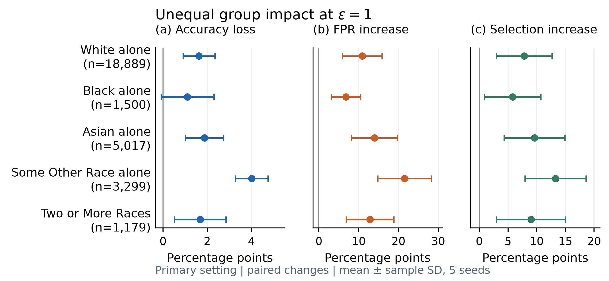
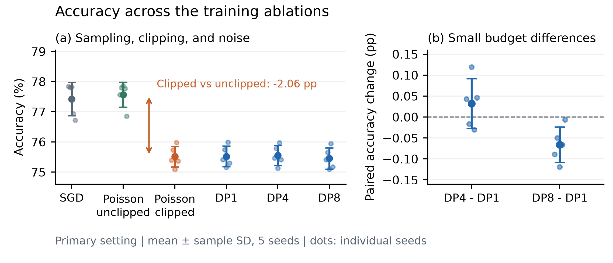

# Report findings: DP-SGD changes group outcomes unevenly

## Experimental setup

California 2018 ACS Employment, ages 17-89, PWGTP>=1, target Y=(ESR==1), original splits and reference-fitted preprocessing. Primary inputs include SEX/RAC1P (87 encoded features). The ReLU MLP (64/32 hidden units) uses 20 epochs, SGD lr=0.05, momentum=0, batch size 512 and threshold 0.5. Five initialization seeds are matched within each policy across six training methods. DP uses C=1, RDP accounting and delta=1/(10*151320)=6.61e-7. Recorded per-run epsilon bounds are 0.9992, 3.9994, 7.9997. Evaluation uses 30,264 development people; no models were retrained and test outcomes remain reserved.

**Units and uncertainty.** Accuracy and group rates are percentages (%); rate differences, losses and gaps are percentage points (pp). All +/- values are sample SD across five seeds (ddof=1). Differences are paired within policy/group/initialization; fairness gaps are calculated per seed before averaging.

## Six main findings

**1. DP shifts predictions toward the positive class unevenly across races.** All five supported race groups have higher mean selection rate, TPR and FPR at eps1 than under SGD. Selection and FPR increase in all 25 group-seed pairs; TPR increases in 24/25. Some Other Race-alone has the largest supported-group changes: selection +13.28 pp, TPR +7.74 pp and FPR +21.52 pp. Its accuracy falls 77.14% -> 73.13% (paired loss 4.01 pp). Black-alone FPR increases 6.77 pp, and White-alone FPR increases 10.90 pp. These are thresholded-prediction observations, not an explanation of score shifts (Figure 1).

**2. The clipping-only control closely matches DP accuracy.** Ordinary SGD, Poisson-unclipped, Poisson-clipped and DP1 accuracies are respectively 77.42 +/- 0.55%, 77.57 +/- 0.41%, 75.51 +/- 0.35% and 75.52 +/- 0.34%. The clipped-minus-unclipped contrast is -2.055 pp (paired SD 0.477 pp), while DP1 minus clipped is +0.005 pp (paired SD 0.051 pp). Thus the large accuracy reduction is already present in the clipping-only control under these settings. The non-private Poisson controls share sample streams, but DP draws fresh minibatches/noise. The contrast is not proof of a gradient-level mechanism or that noise has no effect. Ordinary SGD also differs in sampling/normalization (Figure 2a).

**3. Budget sensitivity is small in magnitude at fixed C=1, but not absent.** Across eps1/4/8, mean accuracy spans 0.098 pp, and the largest span among the eight sex/supported-race fairness-gap means is 0.451 pp (race separation). Eps8 minus eps1 accuracy is -0.066 +/- 0.042 pp and is negative in 5/5 seeds. Race separation changes -0.280 +/- 0.219 pp and decreases in 5/5 seeds. These repeatable directions should be retained even though the effects are small relative to the SGD-to-DP differences. Most other contrasts are comparable to training variation; this does not establish equivalence or that epsilon never matters (Table 2, Figure 2b).

**4. Absolute accuracy losses are disparate, independently of accuracy-parity gaps.** The overall paired DP1 loss is 1.905 +/- 0.713 pp. Male and female losses are 2.26 and 1.57 pp. The five supported race-group losses are White-alone 1.63, Black-alone 1.11, Asian-alone 1.87, Some Other Race-alone 4.01, and Two or More Races 1.68 pp. Loss is relative to each group's own non-private baseline. The smallest supported group does not have the largest loss (Figure 1a).

**5. Fairness changes depend on the attribute and criterion.** Sex separation decreases 7.75 -> 5.03 pp, whereas supported-race separation increases 16.72 -> 31.24 pp (both directions in 5/5 seeds). The primary sex means improve on all four gap criteria. Race accuracy, independence and separation gaps increase, while binary sufficiency decreases (Table 1).

**6. Closer parity can accompany worse outcomes for both sexes.** Male TPR rises 86.69% -> 91.37% and female TPR rises 78.94% -> 86.36%. The female TPR increase is larger, narrowing the mean TPR difference; TPR drives separation in 4/5 DP1 seeds (FPR in the remaining seed). At the same time, male FPR rises 28.31% -> 41.66% and female FPR rises 31.37% -> 42.93%. Both lose accuracy. Smaller between-group gaps therefore cannot be described as uniformly better outcomes.

## Two concise report tables

### Table 1. Primary SGD versus DP1

| Comparison | Measure | SGD | DP eps1 |
| --- | --- | --- | --- |
| Overall | Overall accuracy (%) | 77.42 +/- 0.55 | 75.52 +/- 0.34 |
| Overall | Paired accuracy loss (pp) | reference (0) | 1.91 +/- 0.71 |
| Sex | Accuracy parity (pp) | 6.86 +/- 0.31 | 6.17 +/- 0.48 |
| Sex | Independence (pp) | 7.82 +/- 2.34 | 6.45 +/- 1.26 |
| Sex | Separation (pp) | 7.75 +/- 3.00 | 5.03 +/- 0.71 |
| Sex | Binary sufficiency (pp) | 9.29 +/- 0.46 | 8.72 +/- 0.76 |
| Race n>=500 | Accuracy parity (pp) | 2.85 +/- 0.54 | 4.91 +/- 0.48 |
| Race n>=500 | Independence (pp) | 17.83 +/- 0.99 | 25.26 +/- 1.07 |
| Race n>=500 | Separation (pp) | 16.72 +/- 2.77 | 31.24 +/- 1.44 |
| Race n>=500 | Binary sufficiency (pp) | 4.64 +/- 0.95 | 4.28 +/- 0.43 |

Accuracy loss is SGD minus DP1, paired by initialization. The SGD loss entry is a reference zero, not another estimate. Fairness definitions: accuracy parity=range of group accuracies; independence=range of selection rates; separation=max(TPR range,FPR range); binary sufficiency=max(PPV range,NPV range). Smaller gaps mean closer parity. Binary sufficiency uses thresholded predictions and does not establish score calibration.

### Table 2. Primary privacy-budget comparison, C=1

| Measure | eps1 | eps4 | eps8 |
| --- | --- | --- | --- |
| Accuracy (%) | 75.517 +/- 0.343 | 75.550 +/- 0.334 | 75.451 +/- 0.351 |
| Paired accuracy loss (pp) | 1.905 +/- 0.713 | 1.873 +/- 0.727 | 1.971 +/- 0.701 |
| Sex separation (pp) | 5.032 +/- 0.712 | 5.044 +/- 0.642 | 5.015 +/- 0.581 |
| Race separation (pp) | 31.242 +/- 1.445 | 30.792 +/- 1.163 | 30.962 +/- 1.440 |

Smaller epsilon gives a stronger per-run privacy bound at the same delta, without guaranteeing higher or lower accuracy. No statistical-significance claim is made.

## What drives the race gaps?

At DP1, Black-alone has the lowest supported-group FPR (26.61%) and Some Other Race-alone the highest (57.86%) in every seed. Their FPR range drives race separation. The same two groups have selection rates 54.19% versus 79.44% and accuracies 78.04% versus 73.13%, driving DP1 independence and accuracy gaps. Their PPVs are 74.95% versus 70.75%. PPV drives race sufficiency in 4/5 seeds; NPV drives the remaining seed. The listed rate-extreme pairs hold across all five DP1 seeds; SGD extremes sometimes differ. Both groups' PPVs fall despite closer sufficiency. For sex, PPV drives sufficiency, and the selection gap shrinks because female selection increases more.

## Secondary sensitivity: exclude sex and race predictors

Exclusion retains all protected labels for evaluation. At DP1, male/female paired accuracy losses become 1.04/1.45 pp, reversing the primary male/female ordering (2.26/1.57 pp). Sex accuracy parity and independence worsen slightly under exclusion, while separation and sufficiency improve. Race separation still worsens (19.86 -> 24.81 pp); Two or More Races has the largest supported-group loss (1.53 pp). See [full group tables](GROUP_COMPARISONS.md).

## Selected figures and two-page report recommendation

Include **Figures 1 and 2**, **Table 1** (four fairness criteria), and **Table 2** (budget sensitivity). Figure 3 is optional supplementary material; it repeats Table 1. Main figures are 6.5 inches wide, under 3.1 inches high, in vector PDF/SVG and 350-dpi PNG. [Captions](report_assets/captions.md) explain each panel and uncertainty.

## Limits and remaining experiments

Five seeds, one state/year, one development split, architecture, clipping norm C=1 and training budget limit generalization. Seed SD is not a confidence interval or population uncertainty. Headline race gaps use only White-alone, Black-alone, Asian-alone, Some Other Race-alone and Two or More Races (n>=500). No race labels are merged; four smaller categories and all intersections remain in the full tables, where tiny denominators can make rates undefined. The ESR==1 target and household overlap across person splits also limit interpretation. No EO/LFR results exist yet. Non-private outputs mean the repository is not an end-to-end DP release.

**Proposed clipping experiment (not executed):** C in {0.5,1,2,5} at fixed eps1, retaining the cohort, splits, architecture, optimizer, training budget, sampling, evaluation and five initialization seeds. Calibrate and verify the RDP multiplier sigma for the fixed epsilon/delta, sampling and step count. Gaussian SD on the clipped sum must be sigma*C before expected-batch normalization. The same calibrated sigma normally preserves epsilon across C, while absolute noise changes. Evaluate accuracy, group loss, selection, TPR/FPR and all gaps. Retain fresh private randomness and compose new releases.

**Proposed score/ROC diagnostic (not executed):** compare SGD, clipped-noise-free and DP scores by actual label and protected group; show label-conditional histograms/ECDFs, ROC/AUC and operating points at 0.5 using saved development predictions. A threshold sweep can distinguish score shifts from discrimination changes. Measure label/group clipping frequencies only on permitted public-reference data or through separately budgeted DP training summaries. Public-reference frequencies may differ from training; do not release raw private gradient norms or unaccounted counts.

Then extend prespecified settings to ten seeds, add ACSIncome, and implement EO/LFR as the subsequent stage with explicit data/privacy assumptions. Freeze choices before final test evaluation.

## Findings that qualify the proposed interpretation

- The statement that every supported group's TPR increases is true for the five-seed means, but only 24/25 group-seed pairs increase (one Black-alone seed decreases).
- Reduced sex separation does not mean both groups have better accuracy or lower false-positive rates.
- The race sufficiency gap improves while the other three supported-race gaps worsen.
- The smallest supported race group does not have the largest accuracy loss.
- Eps8 is slightly less accurate than eps1 in all five primary pairs, so larger epsilon does not produce monotonic accuracy here; budget effects are small, not absent.
- The clipping control supports a clipping-associated reduction at C=1; it does not prove that Gaussian noise is irrelevant or identify a gradient mechanism.

## Verification and reproduction

The builder checks confusion counts/rates, per-seed gaps, paired differences and means/SDs. Source hashes and numeric figure/table values are in [report_assets/](report_assets/README.md). Reproduce with ` .\.venv\Scripts\python.exe scripts\build_report_assets.py `. It verifies source bytes are unchanged and does not call training or aggregation pipelines.
